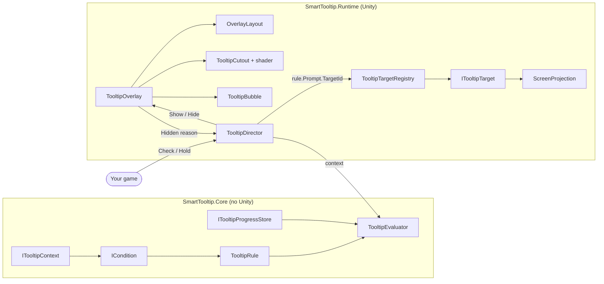
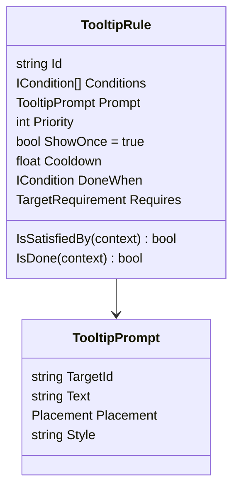
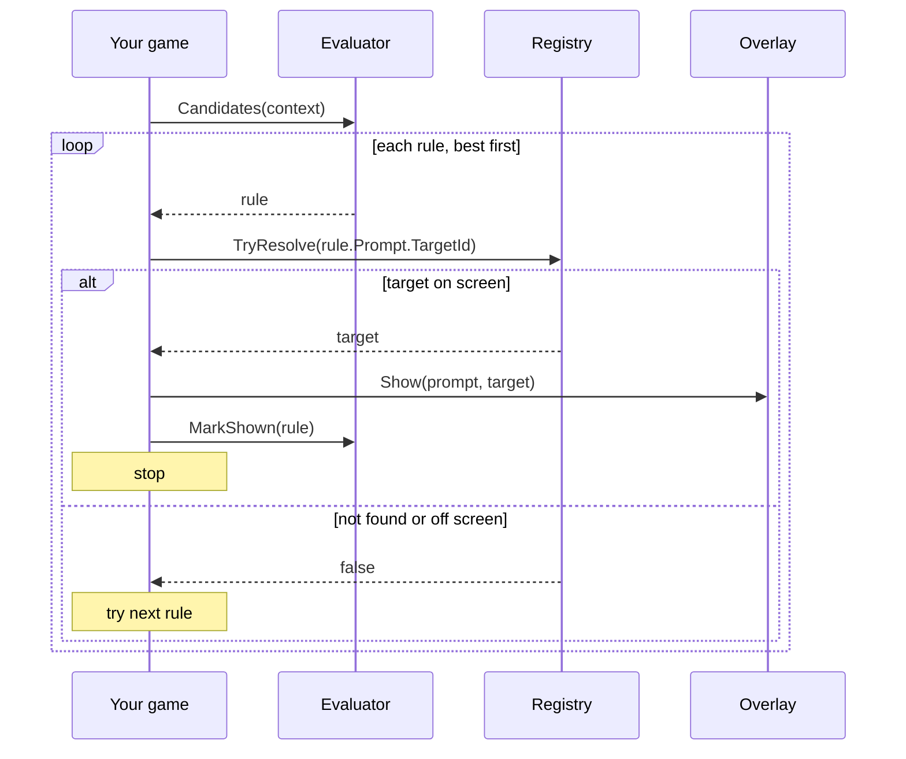
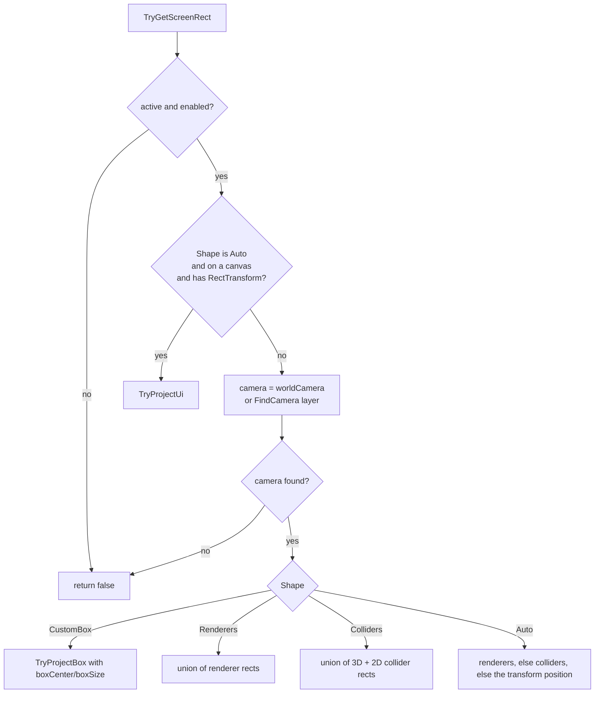
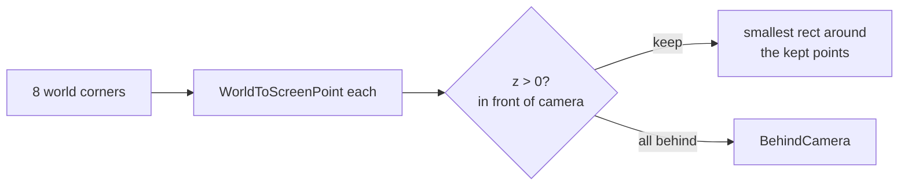
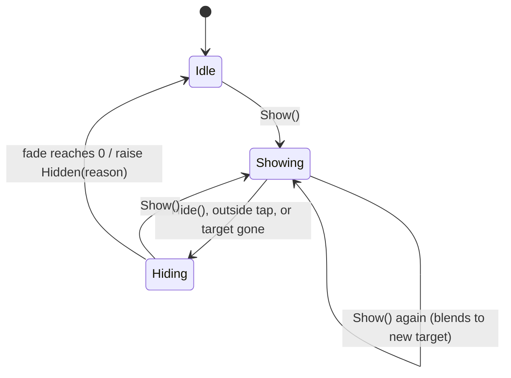
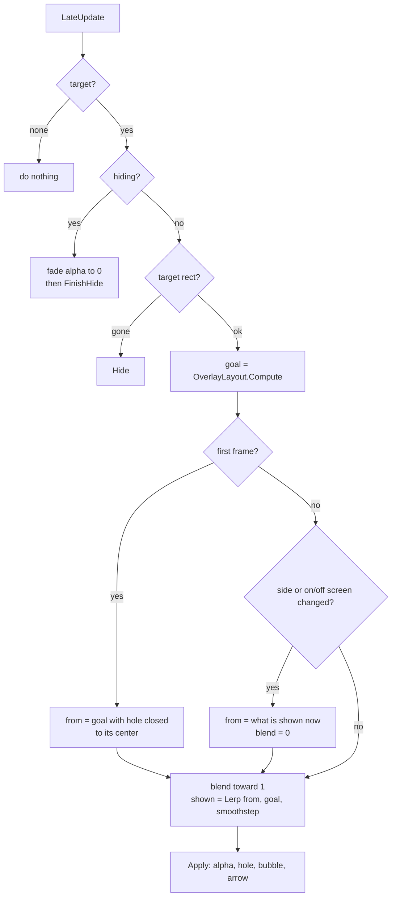
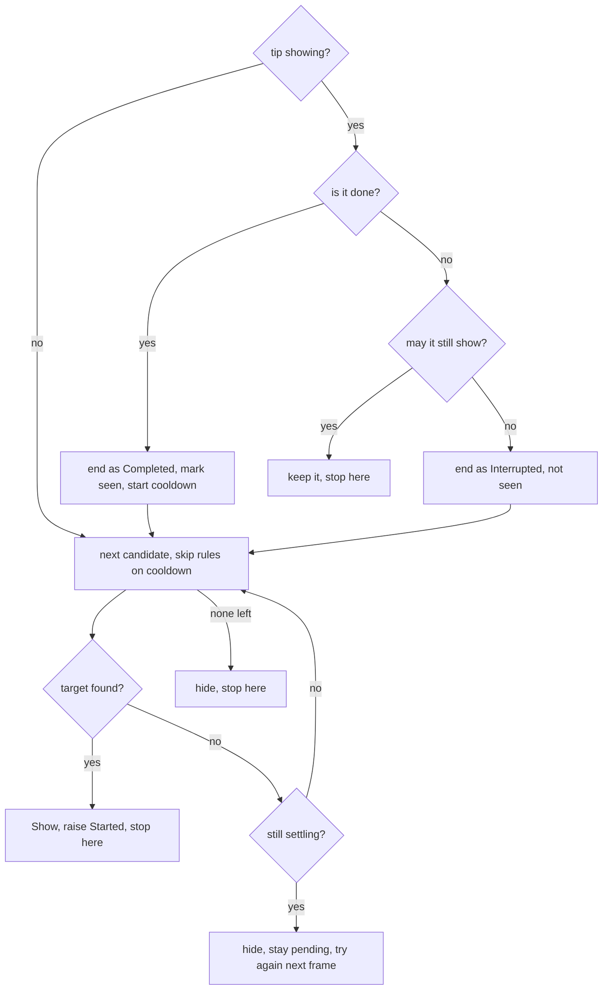

# How Smart Tooltip Works

This note explains what happens inside the package, step by step. It is for you (and future contributors), not for people who only want to use it. For usage, see the repo `README.md`.

> [!summary] The whole idea in three lines
> 1. **Rules** look at your game state and say *which* tip should show.
> 2. **Targets** turn anything (UI, sprite, mesh) into a **rect on screen**.
> 3. The **overlay** dims the screen, cuts a hole around that rect and places a bubble next to it, every frame.
>
> The **director** sits on top and decides *when* to run the rules and what to do with the result.

Each part knows nothing about the parts after it. Rules don't know about Unity. Targets don't know about rules. The overlay only knows "a prompt" and "a target". Only the director knows all three.

---

## Map



### Folders and assemblies

| Folder | Assembly | Why it is separate |
|---|---|---|
| `Runtime/Core` | `SmartTooltip.Core` | `noEngineReferences`. Pure C#, so rules can be unit tested fast and reused outside Unity. |
| `Runtime/Targets`, `Runtime/Overlay`, `Runtime/Progress`, `Runtime/Director` | `SmartTooltip.Runtime` | Everything that needs `UnityEngine` and uGUI. |
| `Runtime/Resources` | (asset) | The cutout shader. In `Resources` so it is always included in builds, even if nothing references it in a scene. |
| `Tests/Editor` | `SmartTooltip.Tests.Editor` | Rule tests. No scene needed. |
| `Tests/Runtime` | `SmartTooltip.Tests.Runtime` | PlayMode tests with real cameras and canvases. |
| `Samples~` | two sample asmdefs | The `~` makes Unity ignore the folder until a user imports a sample. |

---

## Part 1. Rules

The files are in `Runtime/Core`.

### Context

`ITooltipContext` has one method.

```csharp
bool TryGet<T>(string key, out T value);
```

That is all a rule can see. `TooltipContext` is the ready made version, a `Dictionary<string, object>` with a fluent `Set`. You can also implement the interface over your own game state so nothing needs copying.

> [!warning] Types must match for `Is<T>`
> `TryGet<T>` uses `raw is T`. If you `Set("level", 3)` (an `int`) and check `Condition.Is("level", 3L)` (a `long`), it fails. `Compare` does not have this problem, see below.

### Conditions

`ICondition.Evaluate(context)` returns yes or no. The `Condition` static class builds them. Every builder returns the same private `Predicate` class that wraps a `Func<ITooltipContext, bool>`.

| Builder | Matches when |
|---|---|
| `When(func)` | your function says yes |
| `Not(c)` | `c` says no |
| `All(...)` / `Any(...)` | all / any of the inner ones say yes |
| `Is(key, value)` | the key exists, has type `T`, and equals `value` |
| `Has(key)` | the key exists (any type) |
| `Compare(key, op, number)` | the key holds a number and the comparison is true |

`Compare` reads the value as `object` and accepts `int`, `long`, `float` and `double`, then compares as `double`. A missing key or a non number never matches, so `Compare("level", Less, 5)` is **false** when there is no `level` yet. Wrap it in `Not(Has(...))` with `Any` if you want "missing counts as low".

### Rule



A rule answers two separate questions.

| Question | Field | Method |
|---|---|---|
| May it show now? | `Conditions` | `IsSatisfiedBy` is true when all of them are true. No conditions means always true. |
| Has the player done it? | `DoneWhen` | `IsDone` is true when `DoneWhen` is set and true. No `DoneWhen` means never done by state. |

Keeping them apart is the point. Say a tip shows on the home screen and asks the player to visit the Shop. If the player opens Settings instead, the first answer changes to no. The second answer is still no, because the Shop was never visited. The director uses this to tell "left" apart from "finished".

`IsSatisfiedBy` is a plain `for` loop, not LINQ, because it runs for every rule on every check.

`Requires` says what the target needs before the tip can start. `OnScreen` is the default. `Exists` lets a tip start for something off screen or behind the camera.

### Evaluator

`TooltipEvaluator` is built once with all rules and a progress store.

The constructor does two things.

1. Throws if two rules share an id (ids are what the progress store saves, so they must be unique).
2. Sorts by `Priority`, highest first. LINQ `OrderByDescending` is a **stable** sort, so rules with the same priority keep the order you wrote them in.

`Candidates(context)` returns a **lazy** `IEnumerable`. It leaves out rules that were seen, rules that may not show, and rules that are already done.

```csharp
rules.Where(r => !(r.ShowOnce && progress.HasSeen(r.Id)) && r.IsSatisfiedBy(context) && !r.IsDone(context));
```

Lazy matters. The usual loop is "take the first candidate whose target is on screen". Because nothing is computed ahead of time, rules after the one you pick are never evaluated.



`MarkShown` only writes to the store when `ShowOnce` is true. A repeatable rule is never recorded.

This is the loop the director runs for you (Part 4). It calls `MarkShown` later, when the tip ends, not straight after `Show`.

### Progress stores

| Store | Where it saves |
|---|---|
| `InMemoryProgressStore` | a `HashSet`, lost on quit. Good for tests and demos. |
| `PlayerPrefsProgressStore` | one PlayerPrefs string, ids joined with `\n`, default key `smarttooltip.seen`. Loaded once in the constructor, saved on every new `MarkSeen`. |

Use a key per account if one device can have many players. For cloud save, implement `ITooltipProgressStore` yourself (three methods).

---

## Part 2. Targets

The files are in `Runtime/Targets`.

### The one rule every target follows

> [!important] Screen rect convention
> A target reports a `Rect` in **screen pixels**, with **(0, 0) at the bottom left** (same as `Input.mousePosition` and `Camera.WorldToScreenPoint`).
>
> - The rect **may be off screen**. That is on purpose, so the bubble can point toward it.
> - `TryGetScreenRect` returns **false only when the target is gone** (disabled, destroyed, no camera).

Everything after this point (layout, hole, taps) works in that same pixel space, so a UI button, a sprite and a 3D mesh all look the same to the overlay.

### Registry

`TooltipTargetRegistry.Default` is a global lookup from id to targets.

- `byId` is a `Dictionary<string, List<ITooltipTarget>>`. Many targets can share an id, for example every "enemy".
- `registeredIds` is the reverse map, from a target to the id it was saved under. This makes `Register` safe to call again after the id changes. It first unregisters with the **old** id, then adds with the new one.

There are two ways to look a target up.

| Method | Returns |
|---|---|
| `TryResolve(id)` | the newest target with that id whose rect is on screen. `ScreenProjection.IsOnScreen` checks if the rect overlaps the screen at all. |
| `TryFind(id)` | the same as `TryResolve` if one is on screen. If not, the newest one that has a rect at all, even off screen or behind the camera. |

> [!note] Why two methods
> For UI, a tip should only **start** when the player can see the thing. In a 2D or 3D world, you often want to point at something the player can't see yet. A rule picks one with `Requires`. Once a tip is showing, the overlay follows the target either way, on or off screen.

### TooltipTarget component

| Unity event | What it does |
|---|---|
| `OnEnable` | `Refresh()` (cache renderers, colliders, 2D colliders, parent canvas) then `Register` |
| `OnDisable` | `Unregister` |
| `OnTransformChildrenChanged` / `OnTransformParentChanged` | `Refresh()` |
| `OnValidate` (play mode) | re-register, so changing the id in the Inspector works live |

Caching avoids `GetComponentsInChildren` every frame. If you add a renderer deep in the tree at runtime (not a direct child), call `Refresh()` yourself.

This is how `TryGetScreenRect` decides.



Each part (one renderer, one collider) is projected on its own, then all parts are joined with a simple min/max **union**.

### Finding the camera

`ScreenProjection.FindCamera(layer)` tries two things in order.

1. `Camera.main`, if it renders this layer.
2. Otherwise the enabled camera with the **highest depth** that renders this layer.

"Renders" means the camera is active, has no `targetTexture`, and its culling mask includes the layer. So cameras that draw to a texture, like minimaps, are skipped. The camera array is reused to avoid garbage.

### Projecting a 3D shape

Every world shape becomes **8 corners** (or 1 point). Then `ProjectCorners` does the work.



- **Some corners behind the camera.** They are dropped. The rect uses only the ones in front. This stops a huge wrong rect when a big object crosses the camera plane.
- **All corners behind.** `WorldToScreenPoint` gives a mirrored point (behind you shows up on the opposite side). `BehindCamera` takes the average corner, flips it around the screen center, and pushes it far away (`width + height` pixels from center). The result is a zero size rect well off screen in the direction the player would turn. The overlay then sticks the bubble to that edge.

```
 screen center C, mirrored point M
 direction = normalize(C - M)
 result    = C + direction * (width + height)
```

### Tight fit for rotated objects

`Renderer.bounds` is an **axis aligned** box in world space. When an object turns, that box grows. So for `MeshRenderer` and `SpriteRenderer`, the code uses `localBounds` and transforms the 8 corners with the object (`TryProjectBox`). Same for `BoxCollider` (`center`/`size`) and `BoxCollider2D` (`offset`/`size`). Other renderers (skinned meshes, particles, tilemaps) and other colliders use world `bounds`.

> [!caution] What tight fit can and can't do
> The hole is always a **screen aligned** rect.
> - Turned **in depth** (around X or Y), there is a real gain. A bar at (35, 45, 20) gets about 30% less area than the loose box.
> - Turned **flat on the screen** (only Z, like a 2D sprite rotated 45°), there is **no gain**. A rotated square always needs the same upright rect around it.

### UI targets

`TryProjectUi` gets the 4 world corners of the `RectTransform` and looks at the **root** canvas.

| Render mode | How |
|---|---|
| Screen Space Overlay | `RectTransformUtility.WorldToScreenPoint(null, corner)` |
| Screen Space Camera | same, with the canvas camera |
| World Space | normal 3D projection with the canvas camera, or `FindCamera` |

### WorldTarget

For targets that are not a GameObject (a tile, a point on the ground). It holds a `Func<Bounds>` that is called every time, so it can move. Camera is the one you pass, else `Camera.main`. You register and unregister it yourself.

---

## Part 3. Overlay

The files are in `Runtime/Overlay`, plus the shader in `Runtime/Resources/TooltipCutout.shader`.

### What Awake builds

```
Tooltip Overlay             Canvas (Screen Space Overlay, sortingOrder 32000)
│                           CanvasScaler (1920x1080, match 0.5)
│                           GraphicRaycaster, CanvasGroup
├── Dim                     TooltipCutout (full screen, the dark layer)
└── Bubble                  TooltipBubble (your prefab or the built in one)
    ├── Arrow
    └── Text
```

It has its **own** canvas so it sits above your UI no matter how your canvases are set up. The canvas starts disabled and fully transparent.

The built in bubble needs no art. `DefaultSprites` draws a rounded rect (9 sliced, radius 24) and an up pointing triangle into textures at runtime. The font is Unity's `LegacyRuntime.ttf`.

### States



`IsShowing` is `target != null && !hiding`.

The reason (`Requested`, `OutsideTap` or `TargetLost`) is saved when hiding starts. If something else asks to hide during the fade, the first reason wins. `Show` during the fade cancels it, and `Hidden` is not raised.

### Every frame (LateUpdate)

`LateUpdate` runs after all `Update` calls, so cameras and objects have already moved this frame. It uses `Time.unscaledDeltaTime`, so it still animates when `timeScale` is 0 (a paused game).



> [!tip] Why it follows exactly and only blends sometimes
> `shown = Lerp(from, goal, t)` where `goal` is recomputed **every frame**. When `blend` is 1, `shown == goal`, so a moving target is followed with zero lag. The blend only restarts on a big jump, like a new target, the bubble flipping side, or going on or off screen. Smoothstep `t = b²(3 − 2b)` makes those jumps ease in and out.

### Layout math (OverlayLayout.Compute)

This is a pure function. It takes the target rect, the wanted placement, the safe area minus the margin, the bubble size, the arrow length, the gap and the hole padding, all in screen pixels. It gives back the hole rect, the bubble center, the arrow offset and angle, the side, and whether the target is on screen.

**When the target is on screen**

1. `Hole` = target rect grown by `holePadding`.
2. Choose a side, trying these in order.
   1. The wanted side, if the bubble fits there.
   2. Else the opposite side, if it fits.
   3. Else the first that fits from **Above, Below, Right, Left**.
   4. Else (nothing fits) the wanted side, or for `Auto` the side with the most spare room.

   "Fits" means room between the hole and the area edge ≥ bubble size + gap + arrow length.

**When the target is off screen**

1. Clamp the target center into the area. That point on the edge is the anchor, and the hole closes to it (so the screen is fully dim).
2. The side **points inward**. If the target is further out to the left than up or down, the bubble goes on the Right side of the anchor, and so on. The arrow then faces outward, toward the target.

**Then for both**

1. Place the bubble center on the chosen side, `gap + arrowLength` away.
2. Clamp it inside the area (centered if the bubble is bigger than the area).
3. Put the arrow on the bubble edge that faces the anchor, slid along that edge toward the anchor. The slide stops one arrow length from the corners, so it never leaves the rounded part.

| Side | Arrow angle | Arrow sits on |
|---|---|---|
| Above | 180° | bottom edge, points down |
| Below | 0° | top edge, points up |
| Right | 90° | left edge, points left |
| Left | −90° | right edge, points right |

### Screen pixels vs canvas units

Layout works in **screen pixels** because targets are in screen pixels. uGUI positions are in **canvas units**. The canvas scaler sets `canvas.scaleFactor`, which is used both ways.

- Going in, inspector values like `gap` and `holePadding`, and the bubble size, are multiplied by `scaleFactor`.
- Going out, `bubble.anchoredPosition = BubbleCenter / scaleFactor`. The bubble is anchored at the bottom left (0, 0), so canvas position maps straight to screen position.

### The hole (TooltipCutout + shader)

`TooltipCutout` is a `Graphic` that covers the whole screen. It uses its own material instance of `Hidden/SmartTooltip/Cutout` and sets four values.

| Property | Value |
|---|---|
| `_Hole` | hole as (xMin, yMin, xMax, yMax) in screen pixels |
| `_ScreenSize` | the rect size × scale factor, so UV × this = pixel position |
| `_Radius` | corner radius in pixels |
| `_Softness` | edge blur in pixels |

The fragment shader uses a **rounded box signed distance field**.

```hlsl
float2 p = uv * _ScreenSize.xy;                     // this pixel
float2 q = abs(p - center) - halfSize + radius;
float d  = length(max(q, 0)) + min(max(q.x, q.y), 0) - radius;
alpha   *= smoothstep(-softness, softness, d);      // inside < 0, outside > 0
```

`d` is the distance from the pixel to the rounded hole edge. It is negative inside and positive outside. Smoothstep turns that into a soft edge. The radius is limited to half the hole size so tiny holes stay round. When there is no hole (size under 0.5 px), `_Hole` is moved to (−100000, …) so every pixel counts as outside.

It is a plain UI shader (CG, no lighting), so it works in Built-in, URP and HDRP.

### Taps

The same dim layer does tap filtering.

- `ICanvasRaycastFilter.IsRaycastLocationValid` returns `!hole.Contains(point)`. So uGUI's raycast **passes through** the hole and hits whatever is under it, like the real button. Outside the hole, the dim layer is hit.
- When the dim layer is clicked, `IPointerClickHandler` raises `Clicked`, the overlay raises `OutsideTapped`, and hides if `closeOnOutsideTap` is on.
- While hiding, `CanvasGroup.blocksRaycasts` is off, so the fade out never eats taps.

Both the hole and pointer positions are screen pixels, so no conversion is needed. For games that read input directly (not through the EventSystem), `IsBlocked(point)` does the same check.

#### Taps on the target

A tap inside the hole goes to the game, so the dim layer never hears about it. To know the player tapped the target, the overlay reads the pointer itself in `LateUpdate`, after the EventSystem has already sent the click to the game.

- `PointerInput` reads the main mouse button or touch. It uses the new Input System if the package is installed and turned on, and the old Input Manager otherwise. The asmdef has a version define, `SMART_TOOLTIP_INPUT_SYSTEM`, so the package is not needed.
- A tap only counts if the press **and** the release are both inside the hole, and the target is on screen. A drag that ends in the hole does not count.
- Then the overlay raises `TargetTapped`.

Because this runs after the game handled the click, the game's own button code has already run. When the director checks on the next frame, it sees the new state.

### Show while already showing

If a layout already exists, `Show` sets `from = shown` and `blend = 0`. The next frame computes the new goal and the hole and bubble slide over to the new target instead of fading out and in.

---

## Part 4. Director

The files are in `Runtime/Director`.

`TooltipDirector` is a MonoBehaviour that owns an evaluator, a context and an overlay. It does the bookkeeping every game would otherwise write by hand. It decides **when** to run the rules and **what** to do with the answer.

It depends on interfaces, not on concrete classes. The context is an `ITooltipContext`, the store is an `ITooltipProgressStore`, and targets come from an `ITooltipTargetResolver`. So you can swap any of them without touching the director.

### State it keeps

| Field | Meaning |
|---|---|
| `active` | the rule showing now, or null |
| `pending` | a check is waiting to run |
| `requestFrame` | the frame `Check` was last called in |
| `settleEnd` | when to stop waiting for the best target |
| `holds` | how many holds are open |
| `readyAt` | for each rule id, when its cooldown ends. In memory only. |

### Check is a request, not a call

`Check()` only sets `pending = true` and remembers the frame. `Update` runs the real check once `Time.frameCount > requestFrame`. That gives two things for free.

- Ten `Check()` calls in one frame cost one evaluation.
- A button click that opens a panel is evaluated **next frame**, after uGUI has rebuilt the layout at the end of the click frame.

`settleEnd` is only set when a new check starts, not on every `Check()`. Otherwise a fast `PollInterval` would keep pushing the deadline back, and the fallback would never happen.

When nothing is pending, `Update` does almost nothing. It returns after two field checks, so an idle director costs close to zero.

### One evaluation



"Target found" depends on the rule. With `Requires = OnScreen` it uses `TryResolve`, so the target must be on screen. With `Exists` it uses `TryFind`, so an off screen target is fine.

While settling, only the **first** candidate is tried. That is how "wait for the panel to slide in" works without flashing a lower tip for a split second.

When one tip ends and the next is found in the same evaluation, `Show` is called straight away. The hole slides from the old target to the new one, as described in *Show while already showing*.

### Taps on the target

The director listens to the overlay's `TargetTapped`.

- If the rule has **no** `DoneWhen`, the tap is what finishes it. The tip ends as `Completed`, and a check is requested for the next tip.
- If the rule **has** a `DoneWhen`, the tap does not finish it by itself. The tap often changes game state, though, like opening the Shop. So the director requests a check, and the next evaluation sees whether `DoneWhen` is now true.

### Who ends a tip

The director ends a tip itself for `Completed` and for `Interrupted` (from the evaluation, `Stop` or `Hold`). It clears `active` **before** it calls `overlay.Hide()`. So when the overlay's `Hidden` arrives later, `active` is null and the director ignores it.

If `Hidden` arrives while `active` is still set, the overlay closed on its own.

| `TooltipHideReason` | Ends as | Then |
|---|---|---|
| `OutsideTap` | `Dismissed` | check again |
| `TargetLost` | `TargetLost` | check again |
| `Requested` | `Interrupted` | no check, or the tip would come straight back |

While the overlay is fading out on its own, `Update` skips evaluations. Otherwise a check could keep a tip that is already closing.

Only `Completed` and `Dismissed` call `MarkShown` and start the cooldown. A tip that ends because the player left, the target went away, a hold started or the game quit shows again later.

### Holds

`Hold()` adds one to `holds` and returns a small handle. The first hold calls `Stop()`. `Stop` ends the tip as `Completed` if its rule is already done, and as `Interrupted` if not. A tap that finishes a tip often opens a popup in the same frame, and the popup's hold would otherwise end a finished tip as `Interrupted`. Disposing the last one calls `Check()`. The stopped rule was never marked seen, so it is the first candidate again. Each handle only counts once, so disposing it twice is safe.

### Automatic checks

`Create` checks once at the start. After that, a check is requested when a tip is dismissed, lost or tapped, when the last hold is released, when a scene loads, and every `PollInterval` seconds if that is above 0.

---

## Tests

| Suite | What it checks |
|---|---|
| EditMode (10) | numbers of any type in `Compare`, missing keys never match, `All`, `Any` and `Not`, priority then written order, rules that may not show are skipped, rules that are already done are skipped, show once vs repeatable, duplicate ids throw, a rule without `DoneWhen` is never done, cooldown default and negative cooldown throws |
| PlayMode, overlay (11) | with real cameras, the cube rect, a target behind the camera on the right points right, a shape turned in depth fits tighter, `TryResolve` finds only on screen targets and `TryFind` also finds off screen ones, the hole and bubble sit above, the bubble flips below when there is no room, it follows a moving target, it sticks to the right edge, it points toward a target behind the camera, it hides with `TargetLost` when the target is disabled, a tap in the hole raises `TargetTapped` but a drag into it does not |
| PlayMode, director (13) | checks in one frame become one and run next frame, a done tip is marked seen and the next one shows, leaving ends a tip as `Interrupted` and it comes back, a tip that may still show is kept, an outside tap dismisses, a tap on the target finishes a tip without `DoneWhen`, a tap does not finish a tip with `DoneWhen`, a lost target is not marked seen and shows again, nested holds interrupt and resume, a hold on a tip that is already done ends it as `Completed`, it waits for the best target then falls back, an off screen target starts only with `Exists`, a cooldown delays a repeatable tip |

PlayMode tests save screenshots and a `results.txt` to `Logs/SmartTooltipTests` when run in the editor (not in batch mode). The tap tests call the overlay's press and release methods directly, because a test can't press a real mouse.

---

## Known limits

> [!todo] Things that are not done yet
> - **Every tip dims and blocks.** That fits menus and tutorials, not hints in the middle of gameplay. A quiet hint style is planned, and `TooltipPrompt.Style` is already in the data model for it. The overlay ignores `Style` today.
> - **One tip at a time.** One overlay shows one prompt. Two overlays would stack two canvases at the same sorting order.
> - **No priority interrupts.** A higher priority rule waits until the current tip ends. Urgent tips that push others away could be an option later.
> - **Cooldowns are in memory.** They reset when the game restarts.
> - **Taps on off screen targets.** When the target is off screen there is no hole to tap, so a tip without `DoneWhen` can only be dismissed there.
> - **Settings only from a scene object.** The overlay fields are serialized, not public. `TooltipOverlay.Create()` runs `Awake` straight away with defaults. To change the look, put the component on a GameObject in a scene or prefab.
> - **Hole is a rect.** It is rounded, but always screen aligned. Circles or real outlines would need a different shader input.

## Glossary

- **Anchor.** The rect the bubble is placed against. It is the hole when the target is on screen, and a point on the edge when it is off screen.
- **Area.** `Screen.safeArea` shrunk by `screenMargin`. The bubble never leaves it.
- **Candidate.** A rule that may show, is not done and was not seen.
- **Done.** The player has done what the tip asked. A rule's `DoneWhen` says when.
- **Hold.** A handle that pauses the director until it is disposed.
- **Settle time.** How long the director waits for the best rule's target to appear before showing a lower rule.
- **Side.** Where the bubble sits next to the anchor (Above, Below, Left, Right).
- **Safe area.** The part of the screen not covered by notches or rounded corners.
