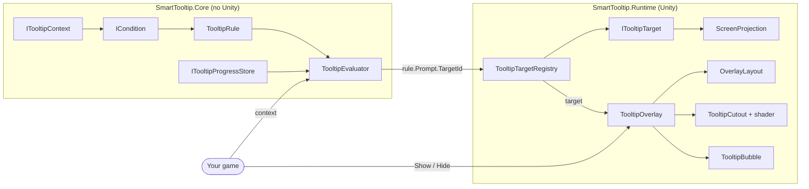
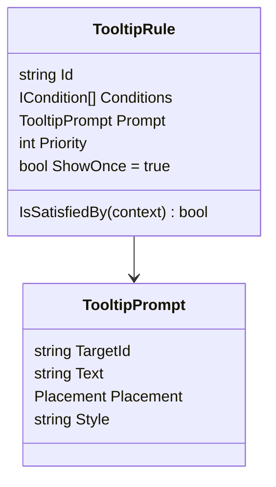
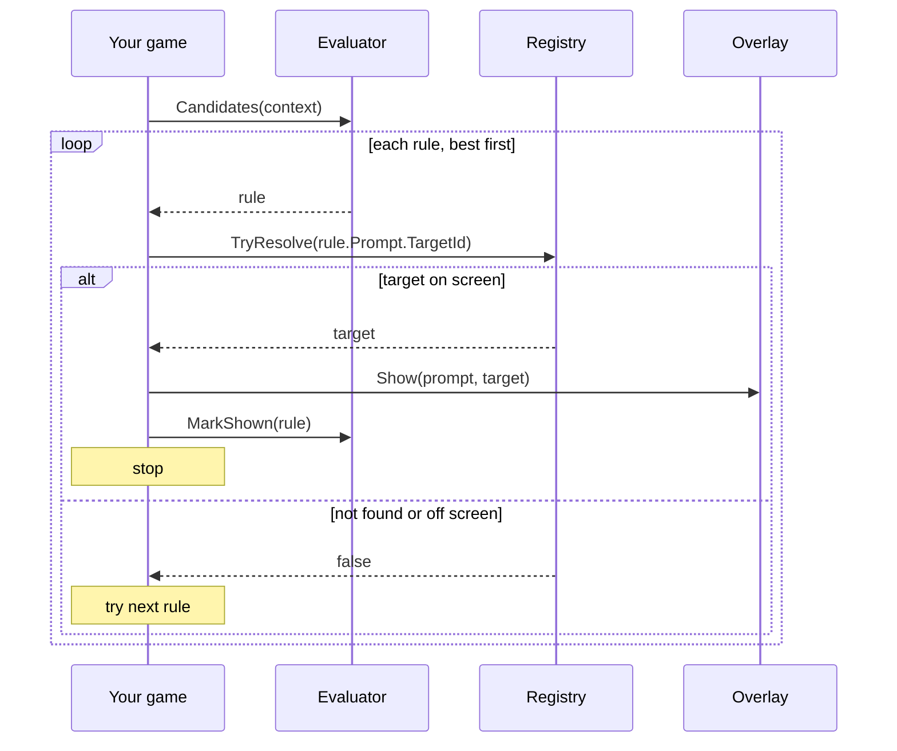
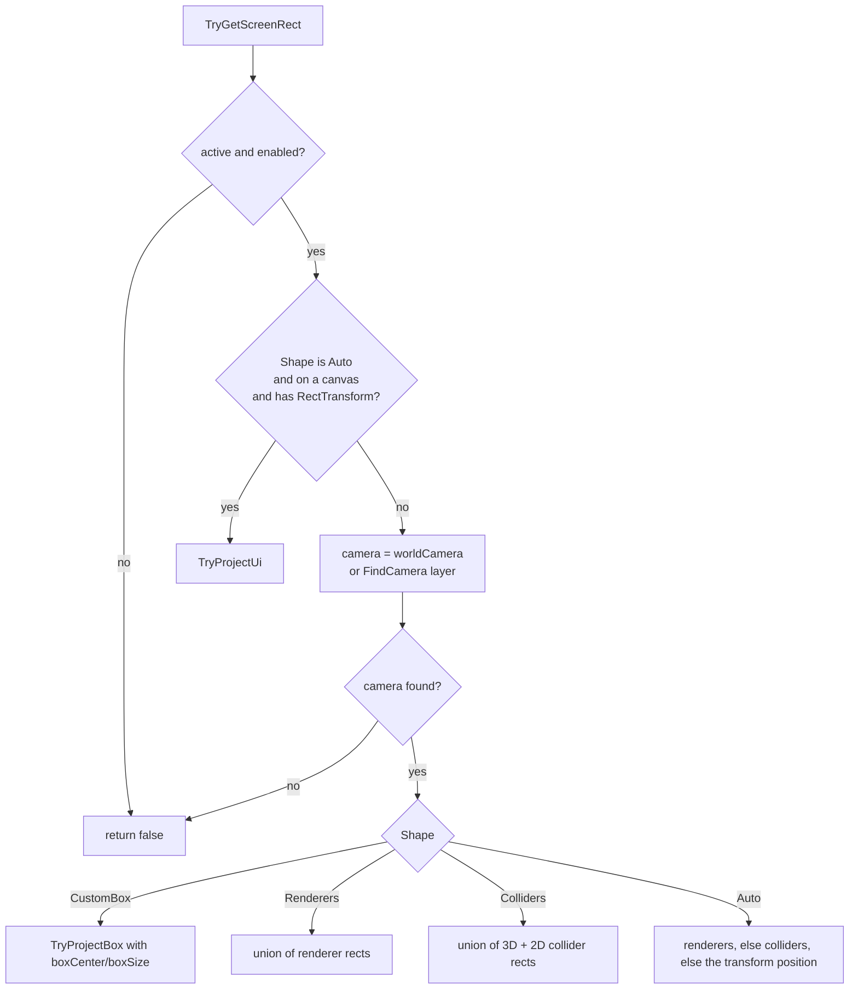
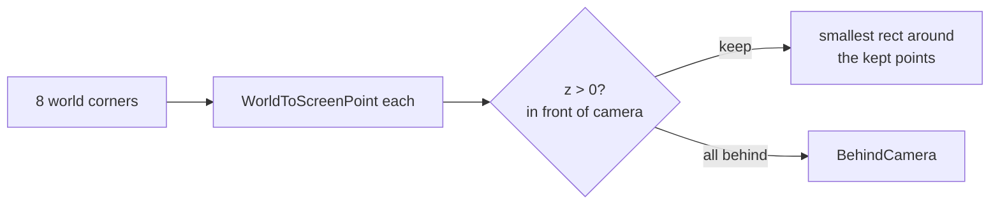
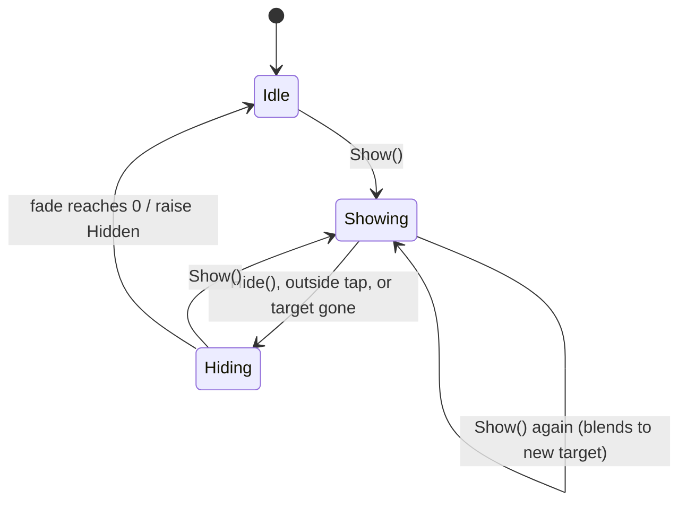
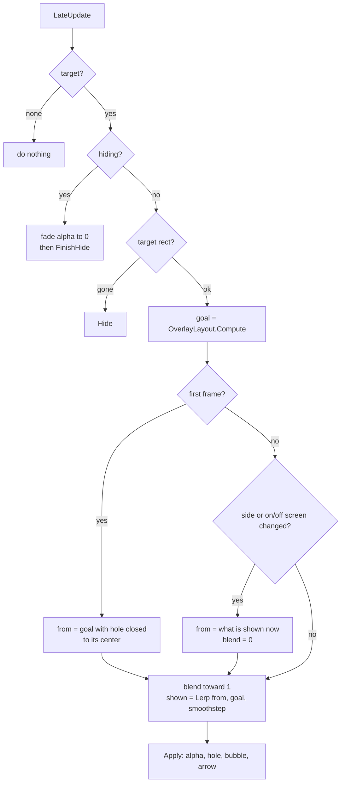

# How Smart Tooltip Works

This note explains what happens inside the package, step by step. It is for you (and future contributors), not for people who only want to use it. For usage, see the repo `README.md`.

> [!summary] The whole idea in three lines
> 1. **Rules** look at your game state and say *which* tip should show.
> 2. **Targets** turn anything (UI, sprite, mesh) into a **rect on screen**.
> 3. The **overlay** dims the screen, cuts a hole around that rect and places a bubble next to it, every frame.

Each part knows nothing about the parts after it. Rules don't know about Unity. Targets don't know about rules. The overlay only knows "a prompt" and "a target".

---

## Map



### Folders and assemblies

| Folder | Assembly | Why it is separate |
|---|---|---|
| `Runtime/Core` | `SmartTooltip.Core` | `noEngineReferences`. Pure C#, so rules can be unit tested fast and reused outside Unity. |
| `Runtime/Targets`, `Runtime/Overlay`, `Runtime/Progress` | `SmartTooltip.Runtime` | Everything that needs `UnityEngine` and uGUI. |
| `Runtime/Resources` | (asset) | The cutout shader. In `Resources` so it is always included in builds, even if nothing references it in a scene. |
| `Tests/Editor` | `SmartTooltip.Tests.Editor` | Rule tests. No scene needed. |
| `Tests/Runtime` | `SmartTooltip.Tests.Runtime` | PlayMode tests with real cameras and canvases. |
| `Samples~` | two sample asmdefs | The `~` makes Unity ignore the folder until a user imports a sample. |

---

## Part 1: Rules

Files: `Runtime/Core/*`

### Context

`ITooltipContext` has one method:

```csharp
bool TryGet<T>(string key, out T value);
```

That is all a rule can see. `TooltipContext` is the ready made version, a `Dictionary<string, object>` with a fluent `Set`. You can also implement the interface over your own game state so nothing needs copying.

> [!warning] Types must match for `Is<T>`
> `TryGet<T>` uses `raw is T`. If you `Set("level", 3)` (an `int`) and check `Condition.Is("level", 3L)` (a `long`), it fails. `Compare` does not have this problem, see below.

### Conditions

`ICondition.Evaluate(context)` returns yes or no. The `Condition` static class builds them. Every builder returns the same private `Predicate` class that wraps a `Func<ITooltipContext, bool>`.

| Builder | Matches when |
|---|---|
| `When(func)` | your function says yes |
| `Not(c)` | `c` says no |
| `All(...)` / `Any(...)` | all / any of the inner ones say yes |
| `Is(key, value)` | the key exists, has type `T`, and equals `value` |
| `Has(key)` | the key exists (any type) |
| `Compare(key, op, number)` | the key holds a number and the comparison is true |

`Compare` reads the value as `object` and accepts `int`, `long`, `float` and `double`, then compares as `double`. A missing key or a non number never matches, so `Compare("level", Less, 5)` is **false** when there is no `level` yet. Wrap it in `Not(Has(...))` with `Any` if you want "missing counts as low".

### Rule



`IsSatisfiedBy` is `Conditions.All(...)`. No conditions means always true.

### Evaluator

`TooltipEvaluator` is built once with all rules and a progress store.

In the constructor:
1. Throws if two rules share an id (ids are what the progress store saves, so they must be unique).
2. Sorts by `Priority`, highest first. LINQ `OrderByDescending` is a **stable** sort, so rules with the same priority keep the order you wrote them in.

`Candidates(context)` returns a **lazy** `IEnumerable`:

```csharp
rules.Where(r => !(r.ShowOnce && progress.HasSeen(r.Id)) && r.IsSatisfiedBy(context));
```

Lazy matters. The usual loop is "take the first candidate whose target is on screen". Because nothing is computed ahead of time, rules after the one you pick are never evaluated.



`MarkShown` only writes to the store when `ShowOnce` is true. A repeatable rule is never recorded.

### Progress stores

| Store | Where it saves |
|---|---|
| `InMemoryProgressStore` | a `HashSet`, lost on quit. Good for tests and demos. |
| `PlayerPrefsProgressStore` | one PlayerPrefs string, ids joined with `\n`, default key `smarttooltip.seen`. Loaded once in the constructor, saved on every new `MarkSeen`. |

Use a key per account if one device can have many players. For cloud save, implement `ITooltipProgressStore` yourself (three methods).

---

## Part 2: Targets

Files: `Runtime/Targets/*`

### The one rule every target follows

> [!important] Screen rect convention
> A target reports a `Rect` in **screen pixels**, with **(0, 0) at the bottom left** (same as `Input.mousePosition` and `Camera.WorldToScreenPoint`).
>
> - The rect **may be off screen**. That is on purpose, so the bubble can point toward it.
> - `TryGetScreenRect` returns **false only when the target is gone** (disabled, destroyed, no camera).

Everything after this point (layout, hole, taps) works in that same pixel space, so a UI button, a sprite and a 3D mesh all look the same to the overlay.

### Registry

`TooltipTargetRegistry.Default` is a global lookup from id to targets.

- `byId`: `Dictionary<string, List<ITooltipTarget>>`. Many targets can share an id (for example every "enemy").
- `registeredIds`: the reverse map, target to the id it was saved under. This is what makes `Register` safe to call again after the id changes: it first unregisters using the **old** id, then adds with the new one.

`TryResolve(id)` walks the list **from newest to oldest** and returns the first one whose rect is on screen (`ScreenProjection.IsOnScreen` checks if the rect overlaps the screen at all).

> [!note] Why "on screen" only at resolve time
> A tip should only **start** when the player can see the thing. Once showing, the overlay keeps following the target even when it leaves the screen. Those are two different questions, so the registry answers the first one and the overlay handles the second.

### TooltipTarget component

Lifecycle:

| Unity event | What it does |
|---|---|
| `OnEnable` | `Refresh()` (cache renderers, colliders, 2D colliders, parent canvas) then `Register` |
| `OnDisable` | `Unregister` |
| `OnTransformChildrenChanged` / `OnTransformParentChanged` | `Refresh()` |
| `OnValidate` (play mode) | re-register, so changing the id in the Inspector works live |

Caching avoids `GetComponentsInChildren` every frame. If you add a renderer deep in the tree at runtime (not a direct child), call `Refresh()` yourself.

How `TryGetScreenRect` decides:



Each part (one renderer, one collider) is projected on its own, then all parts are joined with a simple min/max **union**.

### Finding the camera

`ScreenProjection.FindCamera(layer)`:

1. `Camera.main`, if it renders this layer.
2. Otherwise the enabled camera with the **highest depth** that renders this layer.

"Renders" means: active, `targetTexture == null` (render texture cameras, like minimaps, are skipped) and the culling mask includes the layer. The camera array is reused to avoid garbage.

### Projecting a 3D shape

Every world shape becomes **8 corners** (or 1 point), then `ProjectCorners` does the work:



- **Some corners behind the camera:** they are dropped. The rect uses only the ones in front. This stops a huge wrong rect when a big object crosses the camera plane.
- **All corners behind:** `WorldToScreenPoint` gives a mirrored point (behind you shows up on the opposite side). `BehindCamera` takes the average corner, flips it around the screen center, and pushes it far away (`width + height` pixels from center). The result is a zero size rect well off screen in the direction the player would turn. The overlay then sticks the bubble to that edge.

```
 screen center C, mirrored point M
 direction = normalize(C - M)
 result    = C + direction * (width + height)
```

### Tight fit for rotated objects

`Renderer.bounds` is an **axis aligned** box in world space. When an object turns, that box grows. So for `MeshRenderer` and `SpriteRenderer`, the code uses `localBounds` and transforms the 8 corners with the object (`TryProjectBox`). Same for `BoxCollider` (`center`/`size`) and `BoxCollider2D` (`offset`/`size`). Other renderers (skinned meshes, particles, tilemaps) and other colliders use world `bounds`.

> [!caution] What tight fit can and can't do
> The hole is always a **screen aligned** rect. So:
> - Turned **in depth** (around X or Y): real gain. A bar at (35, 45, 20) gets about 30% less area than the loose box.
> - Turned **flat on the screen** (only Z, like a 2D sprite rotated 45°): **no gain**. A rotated square always needs the same upright rect around it.

### UI targets

`TryProjectUi` gets the 4 world corners of the `RectTransform` and looks at the **root** canvas:

| Render mode | How |
|---|---|
| Screen Space Overlay | `RectTransformUtility.WorldToScreenPoint(null, corner)` |
| Screen Space Camera | same, with the canvas camera |
| World Space | normal 3D projection with the canvas camera, or `FindCamera` |

### WorldTarget

For targets that are not a GameObject (a tile, a point on the ground). It holds a `Func<Bounds>` that is called every time, so it can move. Camera is the one you pass, else `Camera.main`. You register and unregister it yourself.

---

## Part 3: Overlay

Files: `Runtime/Overlay/*`, `Runtime/Resources/TooltipCutout.shader`

### What Awake builds

```
Tooltip Overlay             Canvas (Screen Space Overlay, sortingOrder 32000)
│                           CanvasScaler (1920x1080, match 0.5)
│                           GraphicRaycaster, CanvasGroup
├── Dim                     TooltipCutout (full screen, the dark layer)
└── Bubble                  TooltipBubble (your prefab or the built in one)
    ├── Arrow
    └── Text
```

It has its **own** canvas so it sits above your UI no matter how your canvases are set up. The canvas starts disabled and fully transparent.

The built in bubble needs no art. `DefaultSprites` draws a rounded rect (9 sliced, radius 24) and an up pointing triangle into textures at runtime. The font is Unity's `LegacyRuntime.ttf`.

### States



`IsShowing` is `target != null && !hiding`.

### Every frame (LateUpdate)

`LateUpdate` runs after all `Update` calls, so cameras and objects have already moved this frame. It uses `Time.unscaledDeltaTime`, so it still animates when `timeScale` is 0 (a paused game).



> [!tip] Why it follows exactly and only blends sometimes
> `shown = Lerp(from, goal, t)` where `goal` is recomputed **every frame**. When `blend` is 1, `shown == goal`, so a moving target is followed with zero lag. The blend only restarts on a big jump: a new target, the bubble flipping side, or going on/off screen. Smoothstep `t = b²(3 − 2b)` makes those jumps ease in and out.

### Layout math (OverlayLayout.Compute)

Pure function. Input: target rect, wanted placement, safe area minus margin, bubble size, arrow length, gap, hole padding (all in screen pixels). Output: hole rect, bubble center, arrow offset and angle, side, on screen flag.

**When the target is on screen:**

1. `Hole` = target rect grown by `holePadding`.
2. Choose a side:
   1. The wanted side, if the bubble fits there.
   2. Else the opposite side, if it fits.
   3. Else the first that fits from **Above, Below, Right, Left**.
   4. Else (nothing fits) the wanted side, or for `Auto` the side with the most spare room.

   "Fits" means room between the hole and the area edge ≥ bubble size + gap + arrow length.

**When the target is off screen:**

1. Clamp the target center into the area. That point on the edge is the anchor, and the hole closes to it (so the screen is fully dim).
2. Side = **pointing inward**: if the target is further out to the left than up or down, the bubble goes on the Right side of the anchor, and so on. The arrow then faces outward, toward the target.

**Then for both:**

1. Place the bubble center on the chosen side, `gap + arrowLength` away.
2. Clamp it inside the area (centered if the bubble is bigger than the area).
3. Put the arrow on the bubble edge that faces the anchor, slid along that edge toward the anchor. The slide stops one arrow length from the corners, so it never leaves the rounded part.

| Side | Arrow angle | Arrow sits on |
|---|---|---|
| Above | 180° | bottom edge, points down |
| Below | 0° | top edge, points up |
| Right | 90° | left edge, points left |
| Left | −90° | right edge, points right |

### Screen pixels vs canvas units

Layout works in **screen pixels** because targets are in screen pixels. uGUI positions are in **canvas units**. The canvas scaler sets `canvas.scaleFactor`, so:

- going in: inspector values like `gap` and `holePadding`, and the bubble size, are multiplied by `scaleFactor`.
- going out: `bubble.anchoredPosition = BubbleCenter / scaleFactor`. The bubble is anchored at the bottom left (0, 0), so canvas position maps straight to screen position.

### The hole (TooltipCutout + shader)

`TooltipCutout` is a `Graphic` that covers the whole screen. It uses its own material instance of `Hidden/SmartTooltip/Cutout` and sets four values:

| Property | Value |
|---|---|
| `_Hole` | hole as (xMin, yMin, xMax, yMax) in screen pixels |
| `_ScreenSize` | the rect size × scale factor, so UV × this = pixel position |
| `_Radius` | corner radius in pixels |
| `_Softness` | edge blur in pixels |

The fragment shader uses a **rounded box signed distance field**:

```hlsl
float2 p = uv * _ScreenSize.xy;                     // this pixel
float2 q = abs(p - center) - halfSize + radius;
float d  = length(max(q, 0)) + min(max(q.x, q.y), 0) - radius;
alpha   *= smoothstep(-softness, softness, d);      // inside < 0, outside > 0
```

`d` is the distance from the pixel to the rounded hole edge: negative inside, positive outside. Smoothstep turns that into a soft edge. The radius is limited to half the hole size so tiny holes stay round. When there is no hole (size under 0.5 px), `_Hole` is moved to (−100000, …) so every pixel counts as outside.

It is a plain UI shader (CG, no lighting), so it works in Built-in, URP and HDRP.

### Taps

The same dim layer does tap filtering:

- `ICanvasRaycastFilter.IsRaycastLocationValid` returns `!hole.Contains(point)`. So uGUI's raycast **passes through** the hole and hits whatever is under it, like the real button. Outside the hole, the dim layer is hit.
- When the dim layer is clicked, `IPointerClickHandler` raises `Clicked`, the overlay raises `OutsideTapped`, and hides if `closeOnOutsideTap` is on.
- While hiding, `CanvasGroup.blocksRaycasts` is off, so the fade out never eats taps.

Both the hole and pointer positions are screen pixels, so no conversion is needed. For games that read input directly (not through the EventSystem), `IsBlocked(point)` does the same check.

### Show while already showing

If a layout already exists, `Show` sets `from = shown` and `blend = 0`. The next frame computes the new goal and the hole and bubble slide over to the new target instead of fading out and in.

---

## Tests

| Suite | What it checks |
|---|---|
| EditMode (7) | numbers of any type in `Compare`, missing keys never match, `All`/`Any`/`Not`, priority then written order, rules that fail are skipped, show once vs repeatable, duplicate ids throw |
| PlayMode (10) | real cameras: cube rect, behind camera on the right points right, turned in depth fits tighter, registry only resolves on screen targets, hole and bubble above, flips below when no room, follows a moving target, sticks to the right edge, points toward a target behind the camera, hides when the target is disabled |

PlayMode tests save screenshots and a `results.txt` to `Logs/SmartTooltipTests` when run in the editor (not in batch mode).

---

## Known limits

> [!todo] Things that are not done yet
> - **`TooltipPrompt.Style` is not used.** It is in the data model for the future style system. The overlay ignores it today.
> - **One tip at a time.** One overlay shows one prompt. Two overlays would stack two canvases at the same sorting order.
> - **No driver.** Your game decides *when* to run `Candidates`. A driver that re-checks on events, waits for UI to settle, and holds while the game is busy is on the roadmap.
> - **Settings only from a scene object.** The overlay fields are serialized, not public. `TooltipOverlay.Create()` runs `Awake` straight away with defaults. To change the look, put the component on a GameObject in a scene or prefab.
> - **Hole is a rect.** It is rounded, but always screen aligned. Circles or real outlines would need a different shader input.

## Glossary

- **Anchor**: the rect the bubble is placed against. The hole when on screen, a point on the edge when off screen.
- **Area**: `Screen.safeArea` shrunk by `screenMargin`. The bubble never leaves it.
- **Candidate**: a rule whose conditions pass and that is not already seen.
- **Side**: where the bubble sits relative to the anchor (Above, Below, Left, Right).
- **Safe area**: the part of the screen not covered by notches or rounded corners.
